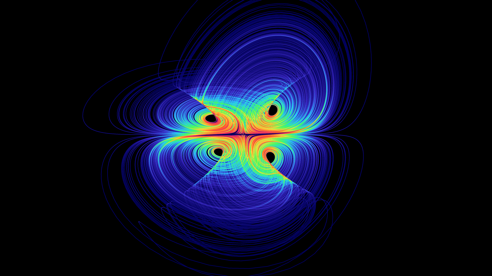

# chaoscope

A pure-C renderer for **strange attractors**, inspired by Nicolas Desprez's
[Chaoscope](https://web.archive.org/web/20190920193544/http://chaoscope.org/download.htm). It integrates a chaotic dynamical system, rotates and zooms a 3D view, cycles a colour palette, and renders the trajectory as a density-accumulated point cloud to a 24-bit BMP.

The core (`chaoscope.c`) is a single-file C99 program with **no third-party
dependencies** — only the standard library (`<stdio.h>`, `<stdlib.h>`,
`<string.h>`, `<math.h>`, `<time.h>`). It builds on Windows, Linux and macOS.

A native **Win32 GUI** (`chaoscope_gui.c`) provides interactive rendering with
live previews, mouse orbiting, palette selection, and animation export.



*Four-wing attractor, rendered with `chaoscope --system fourwing --palette chaoscope`.*

## Features

- **42 attractor systems** out of the box: Lorenz, Rossler, Aizawa, Thomas,
  Halvorsen, Chen, Lu, Rucklidge, Dadras, Burke-Shaw, the Sprott A–S flows,
  Chua, Chen-Lee, Dequan Li, Rabinovich-Fabrikant, Newton-Leipnik, Rikitake,
  Arneodo/Coullet jerk systems, Lorenz-84 and Lorenz mod 2, and more.
- **RK4 integration** with divergence detection and automatic restart.
- **Automatic framing** — the bounding box and scale are estimated from the
  orbit so the attractor always fits the view under any rotation.
- **5 cyclic palettes** (rainbow, fire, ice, plasma, chaoscope) with optional
  cycle phase and output gamma.
- **Density rendering** with interpolated splats, log scaling, and percentile
  normalisation so hot pixels don't crush the contrast.
- **Animation export** — orbiting camera and cycling palette frame sequences.
- **Machine-readable catalogue** (`--list-tsv`) so front ends discover systems
  and palettes without hard-coding them.

## Building

### Command-line renderer

```sh
gcc -O2 -o chaoscope chaoscope.c -lm
```

Any C99 compiler works (gcc, clang, cl). On Windows with MinGW-w64 the `-lm`
is optional.

### Win32 GUI (Windows only)

The GUI shells out to `chaoscope.exe`, so build the core first. It also needs a
resource file (`chaoscope_gui.rc`) for the application manifest; a minimal one
is enough:

```rc
1 24 "chaoscope_gui.manifest"
```

Using MinGW-w64:

```sh
windres chaoscope_gui.rc -O coff -o chaoscope_gui_res.o
gcc -O2 -mwindows -o chaoscope_gui.exe chaoscope_gui.c chaoscope_gui_res.o \
    -lcomctl32 -lcomdlg32 -lgdi32 -luser32
```

Using MSVC (Developer Command Prompt):

```bat
rc chaoscope_gui.rc
cl /O2 chaoscope_gui.c chaoscope_gui.res /link /subsystem:windows
```

Place `chaoscope_gui.exe` next to `chaoscope.exe`, or pass the path to the
renderer as the first argument.

## Usage

```sh
./chaoscope --system lorenz --output attractor.bmp
./chaoscope --system thomas --yaw 30 --pitch 20 --palette rainbow
./chaoscope --system aizawa --width 1920 --height 1080 --iterations 1000000
./chaoscope --system lorenz --animation 120 --prefix lorenz_orbit
./chaoscope --list
```

Run `chaoscope --help` for the full option list.

### Common options

| Option | Description |
| --- | --- |
| `--system <name>` | Attractor system (default `lorenz`) |
| `--list` / `--list-tsv` | List systems, parameters and palettes |
| `--width` / `--height` | Image size in pixels (default 800×600) |
| `--iterations <n>` | ODE steps to render (default 400000) |
| `--dt <f>` | Integration step (default per-system) |
| `--yaw` / `--pitch` / `--roll` | View rotation in degrees |
| `--zoom <f>` | Zoom factor |
| `--panx` / `--pany` | Pan in pixels |
| `--palette <name>` | `rainbow`, `fire`, `ice`, `plasma`, `chaoscope` |
| `--cycle <f>` | Palette cycle phase 0..1 |
| `--splat <n>` | Splat radius 0..4 (default 2) |
| `--gamma <f>` | Output gamma 0.1..10 |
| `--params a,b,c,...` | Override leading system parameters |
| `--seed <n>` | RNG seed (default time-based) |
| `--output <file.bmp>` | Output file (default `attractor.bmp`) |
| `--animation <n>` | Render `n` frames (orbiting camera) |
| `--prefix <str>` | Frame filename prefix (default `frame`) |

## GUI controls

- **Change any control** — quick low-resolution preview, then a full-quality
  render once nothing has changed for ~1 second.
- **Drag** the image — rotate (roll / pitch). **Right-drag** — yaw.
- **Mouse wheel** — zoom. **Spin** — continuous yaw animation.
- **Render animation...** — export a frame sequence.

## Equation sources

The systems are checked against references and numerically verified to stay
bounded with a positive largest Lyapunov exponent at the listed default
parameters and step:

- Chen, Halvorsen, Rucklidge — arXiv:2601.21117 (Attractors section)
- Dadras, Aizawa, Burke-Shaw — ChaoticDynamicalSystemLibrary (Julia) docs
- Four-wing — arXiv:2507.07577, Eq. 3.1
- Thomas — cyclic form, chaos onset `b ~ 0.208186`
- Burke-Shaw parameters — `s = 10`, `v = 4.272` (P. Bourke)

